  

📺 <b>TRANSMISSÃO EM 5 ATOS (CONTRIBUIÇÕES REAIS):</b> O <b>Vico-04</b> caminha pelos meus commits reais das últimas 21 semanas: <b>(1)</b> lustra o commit com lâmina energética, <b>(2)</b> empurra blocos novos pela grade e senta neles pra tomar café, <b>(3)</b> caça bugs vermelhos na matriz, <b>(4)</b> vê o refletor do estúdio despencar do céu falso e <b>(5)</b> bate no vidro e usa o controle remoto contra quem está espiando.

 

### 🎛️ Controle Remoto Interativo — Clique nos botões abaixo para interagir

  
🤜 <b>[BOTÃO 01] Bater no vidro da TV (Provocar o Vico-04)</b>

   
  <blockquote>
    
<code>[CANAL 04 // ÁUDIO INTERNO DO TUBO CRT ATIVADO]</code>

    
🤖 <b>Vico-04:</b> <i>"TOC, TOC É O CARAMBA! Eu já limpei o setor de junho, já empurrei o bloco de outubro no braço, já matei um bug na coluna da direita e o refletor do teto quase caiu na minha cabeça! Vai clicar nos projetos do Iago aí embaixo e me deixa terminar meu expresso em paz!"</i>

  </blockquote>

  
📡 <b>[BOTÃO 02] Inspecionar os Fios da Simulação (Como a TV funciona de verdade)</b>

   
  <blockquote>
    
🔧 <b>Telemetria do Estúdio (O Show de Truman):</b>

    <ul>
      <li><b>Grade Viva:</b> O script <a href="./scripts/generate-tv.ps1"><code>scripts/generate-tv.ps1</code></a> lê diretamente o calendário público de contribuições do GitHub (<code>expeditodeviago</code>) e desenha as últimas 21 semanas pixel por pixel dentro do tubo CRT.</li>
      <li><b>IBOPE Dinâmico:</b> O contador no canto superior esquerdo da TV mostra o total real de contribuições acumuladas no ano.</li>
      <li><b>Turno da Madrugada (GitHub Actions):</b> Todo dia às <b>03:00 BRT</b>, o workflow <a href="./.github/workflows/tv.yml"><code>.github/workflows/tv.yml</code></a> renderiza os 84 quadros da animação com os commits mais recentes e atualiza a transmissão sozinho.</li>
    </ul>
  </blockquote>

  
🟢 <b>[CANAL 05] Sintonizar Dossiê Técnico — NEXUS DASH (IA + Dados)</b>

   
  <blockquote>
    
📊 <b>NEXUS DASH — Intelligent Data Analytics Platform</b> (<a href="https://nexusdash-zeta.vercel.app"><b>Abrir Aplicação Ao Vivo ↗</b></a> | <a href="https://github.com/expeditodeviago/nexusdash"><b>Código-Fonte ↗</b></a>)

    <ul>
      <li><b>Engine de Dados (Python / FastAPI):</b> Upload de CSV/XLSX com limpeza automática em tempo real (moedas, percentuais, inferência de tipos) usando <code>Pandas</code> e <code>NumPy</code>.</li>
      <li><b>NEXUS AI (Llama-3.1 via Groq):</b> Chat contextual que recebe um resumo estatístico em Markdown extraído da planilha para responder perguntas sobre tendências e anomalias sem alucinar.</li>
      <li><b>Arquitetura Stateless (DevSecOps):</b> Processamento 100% em memória RAM (<code>BytesIO</code>) com isolamento por sessão UUID4 e exportação executiva em PDF.</li>
    </ul>
  </blockquote>

  
📘 <b>[CANAL 06] Sintonizar Dossiê Técnico — O LIVRO DAS PALAVRAS (Grimório)</b>

   
  <blockquote>
    
🪄 <b>O LIVRO DAS PALAVRAS — Grimório Interativo de Vocabulário</b> (<a href="https://livro-das-palavras.vercel.app"><b>Abrir Aplicação Ao Vivo ↗</b></a> | <a href="https://github.com/expeditodeviago/livro-das-palavras"><b>Código-Fonte ↗</b></a>)

    <ul>
      <li><b>Repetição Espaçada (Sistema Leitner):</b> Sessões diárias inteligentes onde palavras acertadas espaçam sua reaparição e palavras erradas retornam prioritariamente.</li>
      <li><b>Minigames Multimodais:</b> Múltipla escolha, anagramas, ditado com áudio <code>TTS</code> e reconhecimento de pronúncia via <code>Web Speech API</code>.</li>
      <li><b>O Oráculo (IA):</b> Diagnóstico personalizado dos erros da sessão com progressão de níveis (<i>Aprendiz</i> a <i>Mestre</i>), construído com <code>Next.js</code>, <code>React 19</code>, <code>Prisma ORM</code> e <code>SQLite / Turso</code>.</li>
    </ul>
  </blockquote>

 

  

  

  

  

  

